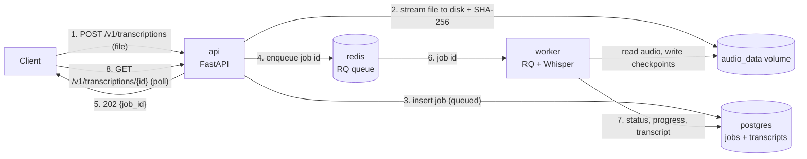
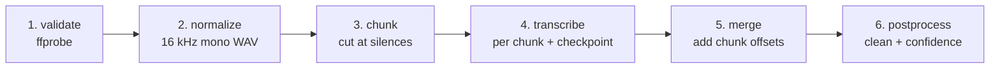

# Transcription Pipeline

A service that turns audio files into text with **timestamps per segment**.
You upload a file (WAV, MP3, M4A, OGG, or anything else ffmpeg can decode). A background worker
normalizes it, splits long recordings at silences, transcribes them with Whisper (faster-whisper), cleans
up the result and stores it. You poll for the result or export it as TXT, SRT, VTT or JSON.

Everything runs with Docker Compose. **A GPU is optional**: the default setup runs on any machine's CPU.

---

## 1. Architecture

### Runtime: four containers



| Service | Role |
|---|---|
| `api` | FastAPI. Accepts uploads, creates jobs, reports status, returns results. **Never transcribes** and loads no model, so it stays fast and small. |
| `worker` | RQ worker. Loads the model **once** at startup, then runs the pipeline for each job. The only container that needs a GPU. |
| `redis` | Job queue (RQ). Also schedules delayed retries. |
| `postgres` | Job records and transcripts (JSONB). |

### The pipeline (`app/pipeline/runner.py`)



1. **validate**: ffprobe must find an audio stream with 0 < duration ≤ `MAX_DURATION_SEC`.
   Otherwise the job fails with `invalid_audio`, `no_audio_stream`, `empty_audio` or `too_long`.
2. **normalize**: ffmpeg converts any input to 16 kHz mono 16-bit WAV. Silences are detected here too;
   a file that is ≥98% silence fails with `no_speech`.
3. **chunk**: files over 10 min are split into ~5 min chunks. Every cut is placed **in the middle of a silence**.
4. **transcribe**: each chunk goes to the engine. Each result is saved as a JSON **checkpoint**, and progress
   (`chunks_done / chunks_total`) is reported after each chunk.
5. **merge**: each chunk's start offset is added to its segment and word timestamps, so all timestamps are
   relative to the original file.
6. **postprocess**: trims whitespace, drops empty segments and likely hallucinations, and collapses repetition
   loops. It computes `confidence = exp(avg_logprob)`, flags `low_confidence`, and renumbers ids.

### Layers and the dependency rule

```
   api/   worker/   cli.py          entry points: choose concrete classes and wire them together
      │          │
      │       infra/                database, file storage, queue (Postgres, disk, Redis)
      │
   pipeline/   engines/             core logic: audio processing and speech-to-text
            │
         core/                      settings, error types, domain models (Segment, Transcript, ...)
```

`core/`, `pipeline/` and `engines/` **never import** FastAPI, SQLAlchemy, Redis or RQ. The pipeline takes a file path, returns a `Transcript`, and reports progress through a
callback. That's why the same code runs in the worker (progress saved to the DB), in the CLI (progress
printed), and in tests (no infrastructure at all).

---

## 2. Files and folders

```
transcript_pipeline/
├── app/
│   ├── api/                    HTTP layer (FastAPI)
│   │   ├── main.py             app factory, startup (connect DB, create tables)
│   │   ├── routes.py           /v1/transcriptions endpoints: upload, get, export, retry, delete
│   │   ├── health.py           /health: DB, Redis, queue depth, worker engine/device
│   │   ├── schemas.py          request/response models (also drive the /docs page)
│   │   ├── errors.py           one error shape for every response: {"error": {"code", "message"}}
│   │   └── dependencies.py     which storage / repository / queue the API uses (tests override these)
│   │
│   ├── worker/
│   │   ├── main.py             load the model once, recover stuck jobs, start the RQ worker
│   │   └── tasks.py            process_job(): run the pipeline, save result, handle errors and retries
│   │
│   ├── pipeline/               how audio becomes a transcript
│   │   ├── runner.py           the 6 steps, in order, plus per-chunk checkpoints
│   │   ├── audio.py            ffprobe / ffmpeg: probe, convert to WAV, cut, find silences
│   │   ├── chunking.py         plan_chunks(): choose cut points inside silences
│   │   ├── merge.py            shift chunk timestamps by their offset and concatenate
│   │   ├── postprocess.py      clean segments, compute confidence, build full text
│   │   └── exporters.py        txt / srt / vtt / json renderers
│   │
│   ├── engines/                which speech-to-text model is used
│   │   ├── base.py             Transcriber interface: load(), info(), transcribe()
│   │   ├── faster_whisper.py   real engine (Whisper on CPU or GPU)
│   │   ├── fake.py             deterministic fake engine for tests and demos
│   │   ├── device.py           pick cuda/cpu and compute type (float16 / int8)
│   │   └── registry.py         engine name -> engine (env TRANSCRIBER_ENGINE)
│   │
│   ├── infra/                  where things are stored and queued
│   │   ├── storage.py          save uploads (streamed, hashed, size-limited), per-job work dirs
│   │   ├── db.py               database connection and the `jobs` table
│   │   ├── repository.py       every read/write of job records
│   │   └── jobqueue.py         enqueue jobs with retry policy; queue depth; worker info
│   │
│   ├── core/                   shared basics
│   │   ├── models.py           domain types: JobStatus, Segment, Word, Transcript, ...
│   │   ├── config.py           all settings, read from environment variables
│   │   ├── errors.py           PermanentError and error codes
│   │   └── logs.py             logging format
│   │
│   └── cli.py                  run the pipeline on one file without API/DB/queue
│
├── tests/
│   ├── unit/                   chunking, merge, postprocess, exporters, engine registry, device choice
│   └── integration/            full API flow (SQLite + fake engine), long-file chunking, checkpoint resume
│
├── docker/
│   ├── api.Dockerfile          small Python image, no ML libraries
│   └── worker.Dockerfile       two targets: `cpu` (default) and `gpu` (CUDA 12 + cuDNN 9)
│
├── scripts/
│   ├── make_samples.sh         generate test audio offline with text-to-speech
│   └── e2e.sh                  upload a file, poll until done, print segments
│
├── samples/                    small sample audio (WAV/MP3/M4A/OGG, silent, corrupt) + example output
├── docker-compose.yml          CPU setup (default): api, worker, redis, postgres
├── docker-compose.gpu.yml      GPU override for the worker
├── requirements-api.txt        pinned API dependencies
├── requirements-worker.txt     pinned worker dependencies (adds faster-whisper, pytest)
├── .env.example                every setting, with a comment
└── pytest.ini
```

---

## 3. Setup

**Requirements:** Docker with Docker Compose. Nothing needs to be installed on the host.

### Run

```bash
# CPU (default, works on any machine)
docker compose up --build

# GPU (optional, NVIDIA driver with CUDA 12 support)
docker compose -f docker-compose.yml -f docker-compose.gpu.yml up --build
```

The first start downloads the Whisper `base` model (~150 MB) into a Docker volume.
`http://localhost:8000/health` shows when the worker is ready and which device it uses.

### Use

Interactive API docs: **http://localhost:8000/docs**

```bash
# Upload -> 202 {"job_id": "...", "status": "queued"}
curl -F "file=@samples/hello.mp3" http://localhost:8000/v1/transcriptions

# Status and transcript (segments with start/end timestamps)
curl http://localhost:8000/v1/transcriptions/<job_id>

# Export as subtitles (txt | srt | vtt | json)
curl "http://localhost:8000/v1/transcriptions/<job_id>/export?format=srt"

# All in one: upload, wait, print segments
./scripts/e2e.sh samples/hello.mp3
```

| Method | Path | Description |
|---|---|---|
| `POST` | `/v1/transcriptions` | Upload `file`; optional `language`, `word_timestamps`. `202` new job · `200` same file already done · `413` too large · `415` not audio · `503` queue full |
| `GET` | `/v1/transcriptions/{id}` | Status, progress, error, transcript. `404` if unknown |
| `GET` | `/v1/transcriptions/{id}/export?format=` | `txt`, `srt`, `vtt`, `json`. `409` if not completed |
| `POST` | `/v1/transcriptions/{id}/retry` | Re-queue a failed job (resumes from checkpoints) |
| `DELETE` | `/v1/transcriptions/{id}` | Delete job, audio and transcript |
| `GET` | `/health` | DB/Redis status, queue depth, worker engine/model/device |

Example output (one segment):

```json
{"id": 0, "start": 0.0, "end": 4.0, "text": "Hello, and welcome to the Transcription Pipeline demo.",
 "confidence": 0.73, "low_confidence": false, "words": null}
```

A full example with word timestamps: [`samples/hello.example.json`](samples/hello.example.json).

### CLI (no API, database or queue)

```bash
docker compose run --rm -v "$(pwd)/samples:/srv/samples" worker \
    python -m app.cli samples/hello.mp3 --format srt
```

### Tests

```bash
docker compose run --rm --no-deps worker python -m pytest -v
```

The tests use the fake engine, so no model is downloaded.

### Sample audio

```bash
./scripts/make_samples.sh
```

This generates speech offline with espeak-ng: the same sentence as WAV, MP3, M4A and OGG, a silent file, a
corrupt file, and an ~18 minute recording with pauses (to see chunking).

### Configuration

All settings are environment variables with defaults; see [`.env.example`](.env.example). To override,
copy it to `.env`. For example, use `WHISPER_MODEL=small` for better accuracy, or `TRANSCRIBER_ENGINE=fake`
to run without a model.

---

## 4. Design decisions

| Decision | Why | Trade-off |
|---|---|---|
| **Async jobs: the API never transcribes** | Transcription takes seconds to minutes. Holding an HTTP request open that long breaks on timeouts and ties up the API. The API stores the file, creates a job and returns `202` immediately; workers do the slow part. | Clients poll for the result (webhooks would remove that). |
| **Queue + separate workers** | Uploads are cheap and transcription is expensive, so they scale separately. Many uploads can be accepted at once; throughput grows by adding worker containers (one per GPU). When the queue is too long, uploads get `503` (backpressure) instead of piling up. | Two more services (Redis, worker) to run. |
| **One normalized audio format** | Format handling lives in one place (`pipeline/audio.py`): ffprobe validates, ffmpeg converts everything to 16 kHz mono WAV, which is what Whisper uses. Any format ffmpeg can decode is supported, and nothing downstream cares. | One extra ffmpeg pass (fast compared to transcription). |
| **Long files: chunk at silences, no overlap** | Cuts fall in the middle of a silence, so no word is split and nothing needs de-duplicating at boundaries. ffmpeg `silencedetect` streams the file, so memory stays constant even for 3-hour files. | With no silence for 7.5 min (e.g. continuous music), it hard-cuts, which may split a word. |
| **Checkpoint per chunk** | If a worker crashes or a job is retried, finished chunks are loaded from disk instead of being transcribed again. | Small JSON files in the job's work dir (deleted when the job completes). |
| **Permanent vs transient errors** | Bad input (corrupt, no audio, silence, too long) fails immediately with a clear error code, since retrying would never help. Anything else (out of memory, crash, timeout) is retried 3 times with growing waits (10 s, 30 s, 60 s). | Errors must be classified correctly. |
| **Recover jobs from dead workers** | A worker killed mid-job leaves the job stuck in `processing`. On startup, workers re-queue jobs with no progress for `STALE_JOB_SEC`, and those jobs resume from their checkpoints. | Recovery runs at worker startup; a periodic sweeper would be better with many workers. |
| **Audio on disk, metadata + transcript in Postgres (JSONB)** | Audio is large binary data and belongs in file/object storage (a shared volume here, S3 in production). Job state needs transactions and lookups (by status, by file hash), and the transcript is a JSON document, so one Postgres row holds both. | Very large transcripts would be better in object storage, with a pointer in the row. |
| **Idempotency by SHA-256** | Uploading the same file with the same engine, model and options returns the existing completed job instead of transcribing it again. | Hashing costs a little CPU during upload. |
| **Engine behind one interface** | `Transcriber` has 3 methods, and each engine converts its output to our own types. Switching engine is the env var `TRANSCRIBER_ENGINE`; adding one is a new file plus one line in `registry.py`. A fake engine makes tests fast and model-free. | A little mapping code per engine. |
| **GPU optional, auto-detected** | The reviewer may not have a GPU. `docker compose up` runs on CPU anywhere; the GPU is an opt-in override. The code picks `cuda` if available and falls back to CPU if the GPU fails to load. | Two image targets (`cpu`, `gpu`) to maintain. |
| **Model loaded once per worker** | Loading Whisper takes seconds. RQ's `SimpleWorker` runs jobs in the same process, so the model (and GPU memory) is reused across jobs. | One job at a time per worker; scale with more workers. |
| **REST API, versioned** | `/v1/...` resources with clear status codes (`202`, `409`, `413`, `415`, `503`), one error format, and OpenAPI docs at `/docs`. | No auth in this demo; API keys and rate limits would come next. |
| **Simple code over many abstractions** | Only the engine has an interface, because it's the part most likely to change. Storage, database and queue are small plain classes that could become interfaces later. The pipeline has no framework imports, so it is easy to test and reuse. | Swapping storage or queue means editing one class. |
